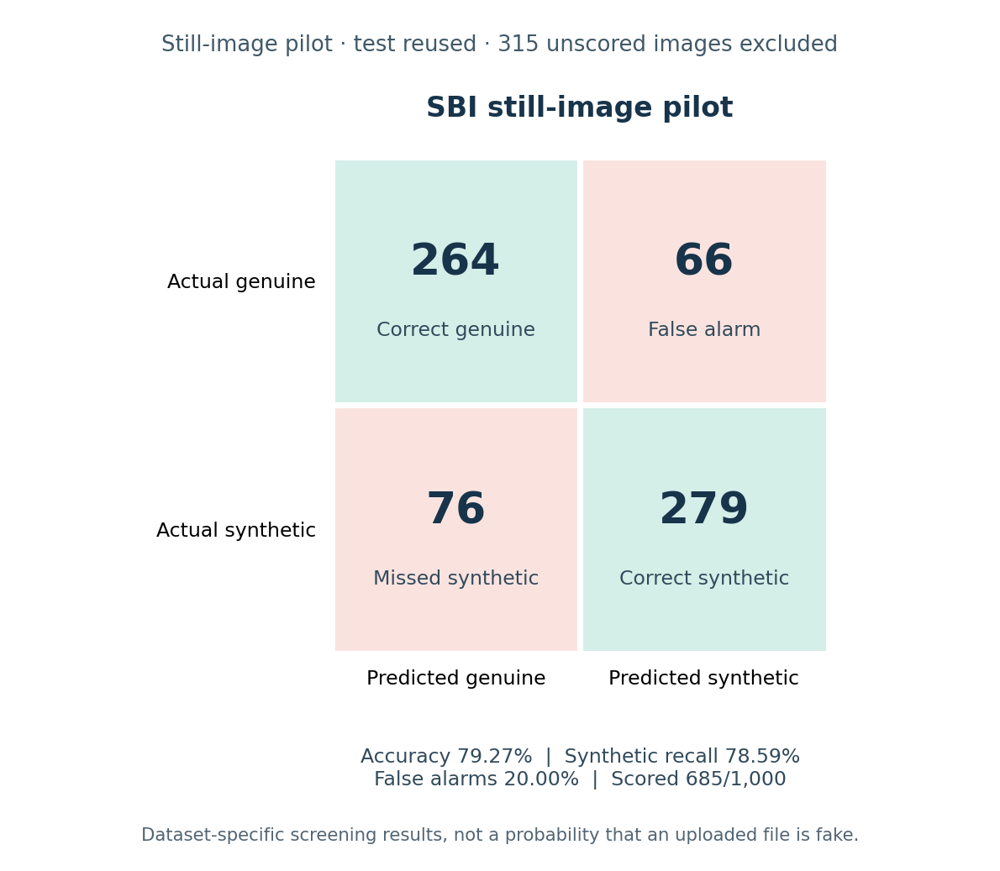
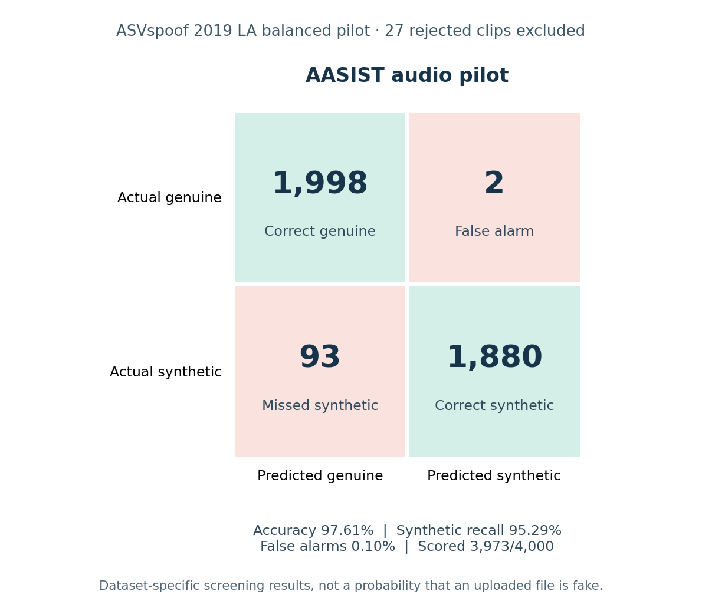
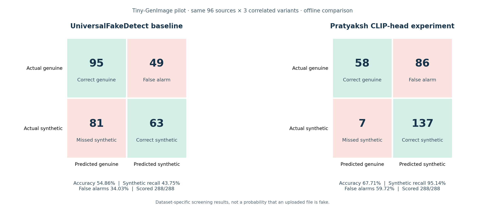
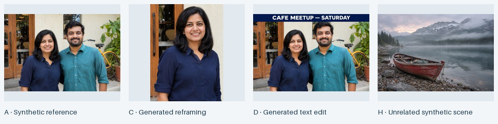

# PRATYAKSH

Pratyaksh is a multimedia-forensics research prototype for examining suspicious photos, videos and audio, comparing related files, and recording explainable findings. It combines deepfake screening, authentication and tampering checks, provenance relationships, and case reports in one React/TypeScript and FastAPI workspace.

**Research prototype:** a detector score is not a percentage of AI content, a proof of authenticity, or a legal conclusion. Results below describe specific experiments. There is no single validated accuracy for the whole application.

## Screens

Case overview, consolidated Media Analysis with four separate technical result channels, provenance and multi-file comparison, a referenced Review & Report workflow with analyst approval, searchable evidence inventory, three-pane evidence workbench, evaluation publication, methods and limits, session audit log, settings, upload and case creation.

## What the prototype includes

- **Deepfake and synthetic-media screening:** whole-image, face-specific and audio checks; timestamped video-frame scores.
- **Authentication and tampering:** preserved-file fingerprint comparisons, metadata and available classical examination methods. Integrity means unchanged since the recorded reference, not genuine before intake.
- **Provenance and source relationships:** exact-copy grouping, image/region comparisons, recorded metadata and available Content Credentials checks. A graph connection opens its supporting evidence; it does not establish an original uploader or a forwarding chain.
- **Reports and explainability:** case findings, examination scope, supporting references, review notes and saved report revisions.
- **Automated case intake:** supported media inside a bounded ZIP can be registered and sent to applicable checks. Completion of processing does not mean every file is authentic or every check was available.

This inventory includes local/offline experiments; documenting a model does not mean its experimental code or weights are published or active on every checkout. Capabilities depend on installed tools, downloaded model files and configuration. The case activity log is ordinary operational history; the separately chained provenance records have their own verification scope. Neither is an independently trusted timestamp service.

## Models and technology actually used

| Component | Technology | What we did | Current role |
| --- | --- | --- | --- |
| Whole-image detection | UniversalFakeDetect with CLIP ViT-L/14 | Integrated the official pretrained model and evaluated it locally | Live candidate whole-image signal; not a face-swap specialist |
| Whole-image experiment | Frozen CLIP ViT-L/14 + a trained linear classifier | Trained a small head on Tiny-GenImage; kept the encoder frozen | Offline experiment; does not replace the live UFD head |
| Face manipulation | SBI EfficientNet-B4 + OpenCV YuNet face detection | Integrated pretrained SBI, then ran Celeb-DF/DeepfakeTIMIT and still-image fine-tuning experiments | Local integrated app uses the verified still-image pilot when available; deployed profile must be checked |
| Synthetic speech | Pretrained clovaai/AASIST | Integrated and evaluated; no local AASIST weight training | Live execution probe; offline benchmark cutoff is not activated as a final verdict |
| Video baseline | FFmpeg/FFprobe timestamp sampling + UFD | Scores up to 12 sampled frames; retains timestamps, mean/peak signals and coverage | No validated whole-video decision threshold |
| Temporal video experiment | Frozen CLIP face features + LSTM with 64 hidden units | Added training/evaluation tooling and an optional API/UI branch | **Not trained yet; no temporal accuracy or meaningful live temporal score** |
| Recording observations | MediaPipe face/pose landmarks; FFmpeg/RMS audio levels | Added eye/posture observations and audio activity measurements | Observations only; not lie detection, emotion proof, heart-rate or SpO2 measurement |
| Relationships and integrity | SHA-256; perceptual candidate matching; SIFT and geometric verification, with optional LightGlue; C2PA tooling when available | Implemented relationship evidence and verification workflows | Matches and recorded metadata are clues with stated limitations |
| Comparison scheduling | Google OR-Tools CP-SAT | Added budgeted pair selection with file-participation constraints | Optional provenance optimisation; all-pairs default remains available |

Pretrained backbones are third-party research work. Training a classification head or fine-tuning layers is not training the entire model from scratch. Model identities, preprocessing and licensing details are in the [backend documentation](backend/README.md) and [model cards](backend/docs/).

## Datasets actually used in our experiments

| Dataset / collection | How we used it | Recorded size and limits |
| --- | --- | --- |
| **DeepfakeTIMIT + genuine VidTIMIT sources** | Image-level evaluation using deterministic middle frames from face-swap videos; later adaptation comparisons | Initial pilot: 320 source videos → 320 frames; development 160 and test 160, with different identity pairs. This is not a temporal-video accuracy measurement. |
| **Celeb-DF v2** | SBI face-crop fine-tuning | Historical best adaptation used a 120-training-clip Celeb-DF candidate and additional DeepfakeTIMIT development data. The selected run reports 379 training face crops in total. Larger candidates were also compared; more data did not consistently improve results. |
| **Local still-image dataset** (`Desktop/Dataset`) | Cleaned still-image SBI fine-tuning | Selected run used 4,514 eligible training face crops and 662 development crops. Of 1,000 selected test images, 685 produced scores and 315 did not. Upstream collection identity and related identities remain unverified. |
| **TheKernel01/Tiny-GenImage** | Whole-image CLIP-head training and comparison against UFD | 224 training source images → 672 original/JPEG/simulated-screenshot inputs; 64 development sources → 192 inputs; 96 test sources → 288 inputs. Midjourney was excluded from custom-head training/development. |
| **Fresh Tiny-GenImage follow-up** | Evaluate stricter development-selected cutoffs | 90 additional source files → 270 correlated variants, including Midjourney, SD15 and BigGAN. No retraining in this follow-up. |
| **ASVspoof 2019 Logical Access** | Evaluate pretrained AASIST | Development: 2,000 selected clips, 1,990 scored. Evaluation: 4,000 selected clips, 3,973 scored. This is a balanced pilot, not the complete benchmark. |

The Desktop still-image directory currently contains **190,335 image files**. This is an inventory count, **not** a claim that all were trained on, independently sourced or correctly labelled. Frames and edited versions derived from one source are correlated examples.

Dataset sources: [DeepfakeTIMIT/VidTIMIT](https://conradsanderson.id.au/vidtimit/), [Celeb-DF](https://github.com/yuezunli/celeb-deepfakeforensics), [Tiny-GenImage](https://huggingface.co/datasets/TheKernel01/Tiny-GenImage), [ASVspoof](https://www.asvspoof.org/index2019.html).


## Measured results

These rows use different tasks, datasets and cutoffs. Do not rank them as if they were the same test or average them into a project-wide score. Accuracy is measured on scored files; unscored inputs remain visible in coverage.

| Experiment | Correct / scored | Accuracy | Genuine inputs falsely flagged | Manipulated/synthetic inputs missed | Coverage and status |
| --- | ---: | ---: | ---: | ---: | --- |
| UFD, initial DeepfakeTIMIT image pilot | 110 / 160 | 68.75% | 36 / 80 | 14 / 80 | 160 / 160; face-swap benchmark, not whole-image generation accuracy |
| Pretrained SBI, same initial pilot | 77 / 160 | 48.13% | 51 / 80 | 32 / 80 | 160 / 160; historical adapter/protocol |
| Fine-tuned SBI, selected DeepfakeTIMIT comparison | 141 / 160 | 88.13% | 2 / 80 | 17 / 80 | Test reused for model comparisons; not an independent final estimate |
| SBI still-image pilot | 543 / 685 | 79.27% | 66 / 330 | 76 / 355 | **685 / 1,000 scored (68.5%)**; test reused and identity overlap unverified |
| UFD, Tiny-GenImage originals + variants | 158 / 288 | 54.86% | 49 / 144 | 81 / 144 | 288 / 288; 96 source images, correlated versions |
| Custom CLIP head, same Tiny-GenImage test | 195 / 288 | 67.71% | 86 / 144 | 7 / 144 | 288 / 288; **high 59.72% false-positive rate**, offline only |
| Custom CLIP head, stricter-cutoff follow-up | 198 / 270 | 73.33% | 54 / 135 | 18 / 135 | 270 / 270; false-positive rate still 40%, offline only |
| Pretrained AASIST, ASVspoof pilot | 3,878 / 3,973 | 97.61% | 2 / 2,000 | 93 / 1,973 | 3,973 / 4,000 scored (99.325%); scoped audio benchmark |
| Video baseline / new temporal branch | — | **Not established** | — | — | No accepted final held-out video accuracy; LSTM branch not trained |

Further detail: [DeepfakeTIMIT results](backend/docs/DEEPFAKETIMIT_PILOT_RESULTS.md), [SBI model card and serving profile](backend/docs/MODEL_CARD_FACE_SBI_RESEARCH.md), [whole-image experiments](backend/docs/WHOLE_IMAGE_CLIP_PILOT.md), [AASIST pilot](backend/docs/ASVSPOOF2019_LA_PILOT_RESULTS.md), [temporal experiment status](backend/docs/TEMPORAL_VIDEO_EXPERIMENT.md).

### Confusion matrices: what the mistakes look like

**Rows show the actual class; columns show the model's prediction at the recorded experiment cutoff.** “Synthetic” here includes face manipulation where appropriate.

- **Correct genuine (TN):** genuine media correctly kept below the cutoff.
- **False alarm (FP):** genuine media wrongly flagged.
- **Missed synthetic (FN):** manipulated/synthetic media missed.
- **Correct synthetic (TP):** manipulated/synthetic media correctly flagged.

These are experiment classifications, not a change to the live application's inconclusive-result policy.

#### SBI still-image pilot



315 selected images were not scored and are excluded from this 2×2 matrix. They must not be counted as correct genuine predictions. The test sample was reused for model comparisons.

#### AASIST audio pilot



This result applies to the tested ASVspoof 2019 LA sample. It does not guarantee detection of every modern AI voice or establish the speaker's identity.

#### Whole-image baseline versus our trained head



The custom head catches more synthetic inputs at its selected cutoff but also flags many more genuine ones. The matrix makes this trade-off visible. All 288 inputs come from 96 source images, so they are not 288 independent sources.

Aggregate counts and source-record SHA-256 fingerprints: [results-summary.json](docs/evaluation/results-summary.json). This is a documentation export of existing results, **not a new evaluation run**. Raw datasets, predictions and checkpoints remain local. Regenerate figures with `python3 scripts/render_evaluation_figures.py` (requires Matplotlib).

## CP-SAT comparison optimisation

The provenance page now offers a **visual comparison budget**. Google OR-Tools CP-SAT chooses which eligible file pairs receive expensive geometric verification while ensuring each file with eligible comparisons participates. All pairs still receive hash and metadata checks; exact duplicates bypass the visual budget. Selected pairs must pass the existing matcher before becoming graph links.

Unselected visual pairs are explicitly **not examined**, not “unrelated.” Selection priorities can miss genuine crops. The optimiser does not raise detector accuracy. The upload cap remains **12 files**; 100-file analysis is not enabled.

Measured pilot on **12 generated geometric controls**, three timed runs per mode:

| Strategy | Visual pairs verified | Exhaustive-reference links retained | Median complete-analysis time |
| --- | ---: | ---: | ---: |
| All eligible pairs | 65 | 6 / 6 | 1.983 s |
| Simple greedy selection | 12 | 6 / 6 | 1.606 s |
| CP-SAT selection | 12 | 6 / 6 | 1.638 s |

CP-SAT reduced geometric pair-verification calls by **81.54%** and median runtime by **17.41%** against exhaustive comparison in this small pilot. It was slightly slower than greedy. All measured runs, including CP-SAT's slower first run, are in the [benchmark record](docs/evaluation/cp-sat-benchmark.json). This is a generated-control experiment, **not deepfake accuracy or a representative real-world relationship benchmark**.

A separate planner-only test selected 200 of 4,950 artificial candidates and covered all 100 items. It did not decode or match 100 uploaded media files. Setup, API parameters, solver status and limitations: [CP-SAT implementation notes](backend/docs/CP_SAT_PAIR_SELECTION.md).

## Photos, recordings and demonstration files

Demo assets are **separate from training and accuracy evaluation**. A prepared example is suitable for demonstrating a workflow, not for proving model accuracy.



| Media | Purpose and known origin |
| --- | --- |
| [Provenance demo folder](testing/provenance/) | A: AI-generated cafe reference; B: exact-byte copy; C: generatively reframed version; D: generated text edit; E: generated face edit; F: JPEG re-save; G: different-scene app screenshot; H: independently generated lake scene. A is **not** a genuine camera photo, and C is **not** a pixel-exact crop. Only B has a guaranteed exact-byte match to A. |
| [Synthetic ground-truth record](testing/provenance/synthetic-ground-truth.json) | Declared asset-generation relationships and hashes. Intended relationships are supplied test labels, not findings automatically proved by Pratyaksh. |
| [Authentication demo folder](testing/authentication&tamp/) | Original/edited demonstration images, an expected overlay and intake samples. The fictional intake-record pair changes INR 1,250 to INR 9,250. Expected overlays are fixtures, not automatically measured outputs. |
| [Synthetic voice](testing/deepfake/voice/03-synthetic-voice.wav) | Approximately 8.7 seconds, mono PCM at 16 kHz; checks upload, playback and audio-probe execution. No prescribed detector score. |
| [Motion-test video](testing/deepfake/video/04-motion-test.mp4) | Five-second silent H.264 clip; tests playback, seeking and decoding. Contains no faces and is not a face-deepfake benchmark. |
| [Automated case ZIP](testing/automated-case/Pratyaksh-Automated-Demo.zip) | Prepared synthetic workflow case; [ground truth](testing/automated-case/Demo-ground-truth.json) records labels and hashes. Not evidence of detection accuracy. |
| User-supplied phone original and reference screenshots | Used for manual examination/demo discussion. Private phone media stays outside the public repository; third-party screenshots are not represented as our training corpus or our generated work. |

Restricted research datasets and model weights are not redistributed in Git. Check the original providers' terms. SBI is restricted to noncommercial research; the Tiny-GenImage pilot's dataset card records CC BY-NC-SA 4.0.

## Run the integrated prototype locally

Install frontend dependencies with `npm ci`. Create the backend environment and install the relevant dependency groups/model assets using the [backend setup guide](backend/README.md). FFmpeg and FFprobe are needed for recording/video work; optional modules require their own assets.

From the repository root, start the backend:

```bash
PRATYAKSH_CORS_ORIGINS="http://127.0.0.1:5174,http://localhost:5174" \
  backend/.venv/bin/python -m uvicorn main:app --app-dir backend --host 127.0.0.1 --port 8011
```

In a second terminal:

```bash
VITE_API_BASE_URL="http://127.0.0.1:8011" \
VITE_D1_API_BASE_URL="http://127.0.0.1:8011" \
  npm run dev -- --port 5174 --strictPort
```

Open `http://127.0.0.1:5174`. If a port is already occupied, inspect the existing process before starting another server. Fixture mode (`VITE_DEV_FIXTURE=true`) explicitly enables illustrative precomputed findings; fixtures are not live model outputs.

API-backed cases, preserved originals and saved results differ from browser-only prototype mode. Check the active mode and actual endpoint before describing storage or deletion behaviour. The standalone D2 workspace is also documented in [backend/d2/README.md](backend/d2/README.md).

## Checks and documentation

- `npm run build` — TypeScript and production frontend build.
- `npm test` — frontend unit tests.
- `backend/.venv/bin/python -m pytest backend/tests` — backend checks; optional integrations may need extra dependencies.
- [Evaluation procedure](backend/evaluation/README.md) — threshold selection, coverage and held-out testing.
- [Provenance workflow](docs/PROVENANCE_WORKFLOW.md) and [benchmark scope](docs/PROVENANCE_LIGHTGLUE_BENCHMARK.md).
- [D4 user guide](docs/d4/USER_GUIDE.md) and [demonstration guide](docs/d4/DEMO_GUIDE.md).

Use `npm run test:e2e` for the full-stack browser suite when its browser/runtime dependencies are available. Do not equate passing software tests with measured forensic accuracy.
